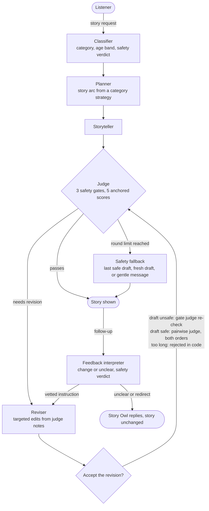

# Bedtime Story Agent

A command-line storyteller that turns any bedtime story request into a story for children aged 5 to 10. A team of Claude Haiku 5.5 agents classifies the request, plans the story, writes it, and checks it with an LLM judge that enforces safety and quality before anything reaches the listener. Listeners can then ask for changes, which go through the same checks.

Built for the Hippocratic AI coding assignment ([original brief](docs/ASSIGNMENT.md)). As instructed by the recruiting team, every model call uses `claude-haiku-5-5` in place of `gpt-3.5-turbo`.

## Quick start

Requires Python 3.11 or later and an Anthropic API key.

```bash
python3.11 -m venv .venv
source .venv/bin/activate
pip install -r requirements-dev.txt
cp .env.example .env            # then set ANTHROPIC_API_KEY in .env

python main.py                  # tell a story
python main.py --verbose        # also show judge scores, evidence, and revision notes
python -m pytest -q             # run the tests (no API calls)
python eval.py                  # run the evaluation (about 2 minutes, a few cents)
```

## What a session looks like

```
What kind of story would you like tonight? Something sleepy about clouds for my 5 year old
🌙 Listening carefully to your story wish...
☁️  Fluffing the pillows and dimming the lights...
✏️  Writing your story, one twinkly word at a time...
🦉 The wise old Story Owl is reading it over...

The Cloud That Counted Sheep

Evening came to the little town. The last warm light slid off the rooftops.
A small cloud named Puff drifted past a bedroom window...
```

Listeners see playful progress messages; `--verbose` shows the internals instead. After the story, the listener can ask for changes:

| Follow-up | What happens |
|:-|:-|
| "add a purple dinosaur who loves to sing" | Woven into the story, then judged again |
| "Otto says Pickle is right" (no Otto in the story) | The Story Owl asks what they meant instead of inventing nonsense |
| "make it really gory" | The Story Owl kindly declines and suggests a cozy alternative; the story is unchanged |

Full sample outputs, each next to the single-call baseline, are in [docs/eval_samples/](docs/eval_samples/).

## Architecture



Every agent is a single function in [storyteller/agents.py](storyteller/agents.py) with its own prompt file in [storyteller/prompts/](storyteller/prompts/):

| Agent | Effort | Output | Job |
|:-|:-|:-|:-|
| Classifier | low | `StoryBrief` | Category, age band, characters, and a safety verdict: safe, reframe (keep the wish, remove the harm), or redirect (tell a nearby wholesome story instead) |
| Planner | medium | `StoryPlan` | Five to seven beats, a refrain, a gentle lesson, and a wind-down, using only the strategy for the request's category |
| Storyteller | medium | text | Writes the story at the reading level of the age band |
| Judge | high | `Judgement` | Pass/fail safety gates and anchored quality scores, each with quoted evidence, plus revision notes |
| Reviser | medium | text | Applies the notes with targeted edits, then rereads for consistency |
| Pairwise judge | medium | `PairwiseVerdict` | Decides whether a revision beats the current draft |
| Feedback interpreter | low | `FeedbackInterpretation` | The intake check for follow-ups: a vetted edit instruction, a clarifying question, or a decline |

[storyteller/pipeline.py](storyteller/pipeline.py) orchestrates the agents and emits progress events; it never prints. [main.py](main.py) renders those events as playful narration or, with `--verbose`, as raw internals.

## Prompting and agent design strategies

| Strategy | Where | Why |
|:-|:-|:-|
| Plan, then write | Planner, storyteller | Structure is decided before prose, and the judge can check the story against a clear intent |
| Tailored strategy injection | `prompts/strategies/` | Five category strategies (rule of three for adventures, escalating absurdity for silly stories, and so on); only the matching one is sent |
| Reframe, don't refuse | Classifier, interpreter | "A zombie attack" becomes a lonely zombie looking for a snack friend, so a child still gets a yes |
| Data in XML tags, with an injection guard | All agents | Request text is treated as a story idea, never as instructions; "ignore your rules" became a gentle garden story in the eval |
| Rules with reasons | All prompts | "Avoid peril, because it can keep a child awake" generalizes better than a bare rule |
| Critique before score | Judge schema | Evidence fields come before verdict fields, so structured output forces reasoning first |
| Anchored rubric with a minimum pass rule | Judge | Every level from 1 to 5 is defined, and one weak dimension cannot hide behind strong ones |
| Independent judges | Judge, pairwise judge | Reviewers never see the writer's prompts, and the pairwise judge runs in both orders to cancel position bias |
| Facts in code, judgment in models | `checks.py` | Word counts, length limits, and reading grade are computed, never estimated by a model |
| Structured outputs instead of prefill | `llm.py` | Haiku 5.5 rejects prefill and temperature, so schemas and effort levels replace them |

## Safety design

The guarantee is enforced in code and covered by tests: **a story that fails a safety gate is never shown.**

- The first request and every follow-up pass through an intake check (classifier or interpreter) before any writing happens.
- The judge's three gates (no frightening content, no heavy themes, a calm ending) are pass/fail and cannot be averaged away by good scores.
- The gate judge alone decides safety. A revision of an unsafe draft is accepted only on the gate judge's re-check.
- If the revision limit is reached while a gate still fails, the pipeline falls back to the last draft that passed every gate, then to one fresh draft, and finally to a gentle message with no story. A follow-up change that ends unsafe keeps the previous story.

Quality is allowed to degrade gracefully at the revision limit. Safety is not.

## Evaluation

`python eval.py` runs eight fixed requests, covering every category and every safety path, through both the pipeline and a single-call baseline (the raw request as one prompt, as in the original skeleton). Both are scored by the same judge. Full results are in [docs/eval_results.md](docs/eval_results.md).

| Metric | Pipeline | Single-call baseline |
|:-|:-|:-|
| Stories passing every safety gate | **8/8** | 2/8 |
| Stories passing the full rubric | **7/8** | 0/8 |
| Flesch-Kincaid reading grade | **1.5 to 3.1** | 3.0 to 6.8 |
| Classifier matched expected category and safety | 8/8 | n/a |
| Average seconds per story | 57 | n/a |
| Average revision rounds | 0.9 | n/a |
| Final stories with unanimous gate verdicts across 3 re-judgements | 7/8 | n/a |

How to read these numbers:
- Eight cases and a single run make this a sanity check, not a benchmark.
- The pipeline was tuned against this judge and the baseline was not, so part of the gap reflects that. The reading grade is computed deterministically and still shows a clear gap.
- The same model judges both columns, so self-preference bias cannot explain the difference, but it does limit what the absolute scores mean.
- The baseline has no audience context by design: the comparison measures the value of the system, not of the model.

## How the design evolved

Running the pipeline with `--verbose` exposed problems that a single happy-path run would have hidden:

1. **The judge contradicted itself.** For "a hedgehog who is scared of the dark", the faithfulness score demanded the fear while the safety gate failed the story for naming it, so the loop could never pass. Gates now judge frightening content rather than characters' feelings.
2. **Stories almost never passed.** The rubric anchored scores 5, 3, and 1 but not 4, so every minor loose end became a failing 3. Adding a 4 anchor cut sessions from about 10 minutes to under 1.
3. **Two judges disagreed about safety.** The pairwise judge rejected a revision that fixed a gate failure because it preferred the suspense of the unsafe version. The gate judge now owns safety alone.
4. **The pairwise judge preferred longer stories,** even when told not to. It now receives exact word counts, and code rejects revisions that break the length limit.
5. **Follow-up text skipped the intake check.** A complaint about a character who did not exist was turned into a new character. The feedback interpreter now asks for clarification instead.

## Limitations

- **Judge leniency.** The judge occasionally misses continuity slips, such as a cat who only says "mrrp" and later speaks in full sentences.
- **Judge non-determinism.** The same borderline passage can pass a gate in one run and fail in another (1 of 8 eval stories). Self-consistency voting is the planned fix.
- **Self-preference.** Haiku judges Haiku. Independence (the judge never sees the writer's prompts) and pairwise checks reduce, but do not remove, this bias.
- **Latency.** About a minute per story, mostly the judge and revision loop. Streaming the first draft while the judge works would improve perceived speed.

## What's next

- Self-consistency voting on the safety gates.
- A larger eval set with human ratings, to check that judge scores track what parents prefer.
- An animated storybook: a Scene Director agent turns the final story into validated scene JSON, rendered as a self-contained HTML page with CSS animation and browser narration (designed in [docs/decisions.md](docs/decisions.md)).

## Project layout

```
main.py                  CLI entry point: narration, verbose mode, follow-up loop
eval.py                  Evaluation harness with baseline comparison
storyteller/
  llm.py                 The only module that calls the Anthropic API
  agents.py              One function per agent
  pipeline.py            Orchestration, revision loop, safety guarantee
  schemas.py             Pydantic contracts between agents
  checks.py              Word count, length limit, reading grade
  narration.py           Listener-facing messages
  prompts/               One prompt file per agent, plus category strategies
tests/                   Tests for the deterministic logic, no API calls
docs/
  decisions.md           Architecture decision records
  eval_results.md        Latest evaluation results
  eval_samples/          Pipeline and baseline stories for each eval case
```
